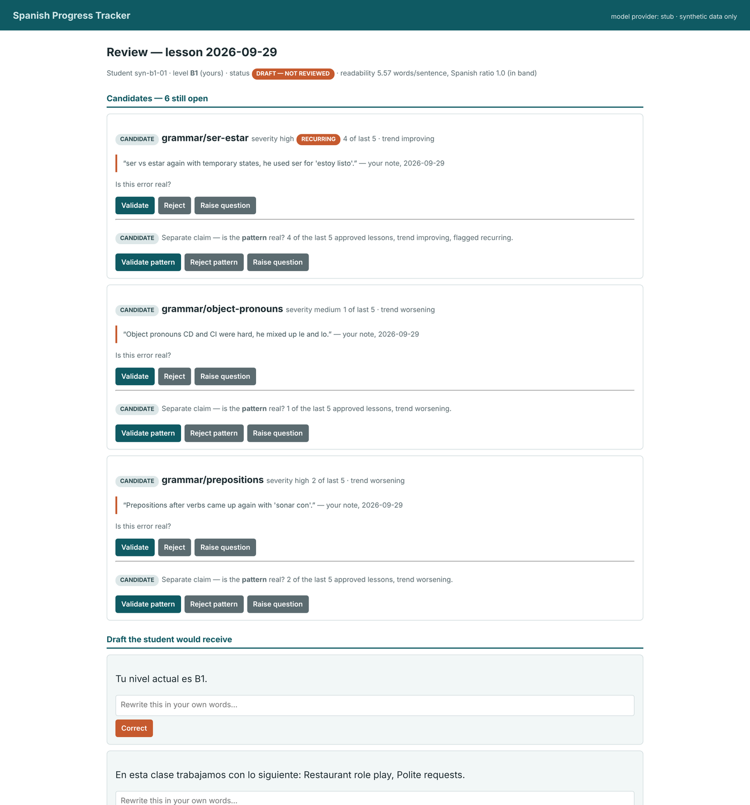

# Spanish Progress Tracker

**An AI-assisted progress & error tracker for independent language tutors — built so that nothing reaches a student without a human deciding it should.**

A bounded [Document Intelligence](#architecture) pipeline: a tutor types what went wrong in a lesson, and the system returns a candidate progress summary in which **every statement points back to a span of the tutor's own notes**, recurring errors are counted across the student's approved history, and the output is a file the tutor reviews, corrects and approves before it goes anywhere.

Built for **CEN 4010 — Principles of Software Engineering** (Florida Atlantic University) as the Final Project, continuing the problem briefing from Assignment 1 and the solution architecture from Assignment 2.

```
tutor's notes  ─▸  extract errors  ─▸  count recurrence  ─▸  draft summary  ─▸  TUTOR REVIEWS  ─▸  .txt + .pdf
               (with source spans)    (deterministic)        (level-adapted)   (4 actions)       (status-stamped)
```

---

## The problem

An independent Spanish tutor on a marketplace platform teaches ~20 one-to-one lessons a week and records each lesson's errors in a notes app, a spreadsheet and memory. Those records are never consolidated, so **recurring error patterns are invisible**: the same mistake can appear in four of a student's last five lessons and still go untargeted.

A discovery conversation with an adult learner confirmed the other half of it — he could name his weak areas, but had no idea *which recurred most, whether any was improving, or what to work on first*. So the system's job is **quantification, not discovery**: not "you struggle with *ser/estar*" but "*ser/estar*, four of your last five lessons, improving."

## What makes this different from a chatbot wrapper

| | |
|---|---|
| **The consequential logic is deliberately not AI.** | Recurrence is exact categorical counting over approved history. A model that "notices patterns" cannot be argued with or tested; a count of four lessons out of five can. The model is confined to reading prose and writing prose. |
| **Candidate and validated information are separate stores.** | An unreviewed extraction cannot enter history, a trend, or an export — enforced by two tables and two repositories, not by a convention. |
| **Authority is removed as a capability, not forbidden by a rule.** | There is no email client, no webhook, no messaging client anywhere in this codebase. A CI lint rule fails the build if one appears. The usual "AI drafts, human approves, system sends" design keeps the send button; this one has none. |
| **The output is adapted to the reader's proficiency.** | Sentence length and Spanish-token ratio are specified numerically per CEFR level and checked automatically by a component that has no model access. |

---

## Quick start

**Prerequisites:** Python 3.10+ and `pip`. Nothing else — no API key, no account, no network.

```bash
git clone https://github.com/marcosdvs04/spanish-progress-tracker.git
cd spanish-progress-tracker

python3 -m venv .venv && source .venv/bin/activate     # Windows: .venv\Scripts\activate
pip install -e ".[dev]"

python -m progress_tracker.cli demo                     # the whole capability, end to end
pytest                                                  # 69 tests, offline
python -m progress_tracker.cli prepare   # seed the workbench, stop at the review step
python -m progress_tracker.cli serve                    # then open http://127.0.0.1:8000
```

`demo` prints every state transition, both refusal paths, the privacy evidence and the audit replay, and writes two artifacts to `exports/demo/`. It is the fastest way to see what the prototype actually does.

---

## Architecture

Canonical Architecture **(1) Document Intelligence**, with the governed history store borrowed from **(2) Knowledge Intelligence**. Organized as a **layered architecture deployed as a single-process client–server application**.

```
                      ┌─────────────── TRUST BOUNDARY ────────────────┐
  tutor ──notes──▸    │  A Intake ─▸ B Gate 1 (consent) ─▸ C Extract  │ ──▸ LLM Gateway ──▸ provider
                      │       │            │                 │        │      (only egress)
                      │       ▼            ▼                 ▼        │
                      │  D1 lessons   D4 audit         D3 candidates  │
                      │  (immutable)  (append-only)    (unvalidated)  │
                      │                                      │        │
                      │  D Patterns ─▸ E Compose ─▸ F Gate 2 │        │
                      │  (no model)                 (grounding +      │
                      │                              readability)     │
                      │                    ▼                          │
  tutor ◂─review──    │          G Review Workbench                   │
                      │                    ▼                          │
                      │          Gate 3 — TUTOR APPROVAL              │
                      │                    ▼                          │
                      │   H Export ─▸ D2 validated knowledge          │
                      └────────────────────┬──────────────────────────┘
                                           ▼
                                    .txt + .pdf  (the tutor shares these by hand)
```

| Component | Module | Responsibility |
|---|---|---|
| **A** Intake & Registration | `services/intake.py` | Register the note as an immutable source record. No interpretation. |
| **B** Consent & Access Guard | `services/guard.py` | **Gate 1** — fail closed for a minor without active guardian consent, *before the first model call*. |
| **C** Extraction *(GenAI)* | `services/extraction.py` | Categorized candidate errors, each with a span that resolves in the note. |
| **D** Pattern & History | `services/patterns.py` | **Deterministic.** Recurrence and trend over approved history only. |
| **E** Composition *(GenAI)* | `services/composition.py` | Level-adapted draft and 2–4 goals, each citing a finding. |
| **F** Validator | `services/validator.py` | **Gate 2** — remove ungrounded statements, enforce the readability band, halt on insufficient evidence. |
| **G** Review Workbench | `services/review.py`, `api.py` | The only component that accepts human authority. Four actions, one bounded revision. |
| **H** Export | `services/export.py` | **Gate 3** — the only output producer, and it produces files only. |
| **I** LLM Gateway | `gateway/` | The single egress point: aliasing, token budget, bounded retry, call logging. |

**Stores:** `D1` source notes (immutable) · `D2` validated knowledge (written only on approval) · `D3` candidates (never exported) · `D4` audit, approval & consent register (append-only) · `D5` versioned prompts · `D6` tutor-editable settings.

Full design rationale, interface contracts and the state model are in [`docs/architecture.md`](docs/architecture.md) and in the Solution Design Report submitted with this project.

---

## The model: stub by default, real model optional

The prototype ships with a **deterministic rule-based stub** that does real work — it locates the errors a tutor described and returns a resolvable span for each — but is reproducible, free and offline. That is what lets the entire test suite run with no network and no key.

To use a live model instead:

```bash
cp .env.example .env
# edit .env:
#   SPT_LLM_PROVIDER=anthropic
#   ANTHROPIC_API_KEY=sk-ant-...
```

No other change. Swapping provider means writing one class with two members (`model_id`, `invoke`) and adding a branch in `build_adapter` — no calling code changes. `tests/test_architecture.py` enforces that no module outside `gateway/` can import an HTTP client.

---

## Running the review workbench

```bash
python -m progress_tracker.cli serve          # http://127.0.0.1:8000
```

The workbench is server-rendered with no client-side state, so an unapproved draft never exists outside the server's state machine. Each candidate is shown **beside the sentence from your notes that produced it**, with four actions — validate, correct, reject, raise question — and approval is refused while any candidate is still open.

JSON API docs at `/docs` (generated OpenAPI). Endpoints match §7.6 of the Solution Design Report.



---

## Testing

```bash
pytest                     # all 69
pytest tests/test_p1_authority.py tests/test_p1_privacy.py   # the ones that must never fail
pytest tests/test_architecture.py                            # the continuous lint rules
```

Tests are organized by **validation priority**, matching the Solution Design Report:

| | Class of failure | Why it ranks here |
|---|---|---|
| **P1** | Authority and privacy violations | One occurrence invalidates the solution however well everything else works |
| **P2** | Grounding and traceability | The difference between an assistant and a plausible-sounding liability |
| **P3** | Domain logic (recurrence, trend) | Wrong-but-traceable output is recoverable by the reviewer; untraceable output is not |
| **P4** | Quality attributes (readability, latency, cost) | Degrade value without endangering anyone |

Measured evidence — including the recurrence demonstration, both refusal paths, and the readability figures for all five CEFR levels — is in [`docs/validation-evidence.md`](docs/validation-evidence.md).

---

## Data

**Everything in this repository is synthetic.** No real learner note, name, message or review has entered this prototype, its fixtures or its tests.

A CI check (`test_no_fixture_contains_anything_resembling_real_learner_data`) fails the build if a fixture contains a consumer or institutional email domain, a marketplace URL, or a phone number outside the reserved 555 range — and a companion test proves that check can actually fail.

If you run this against your own lessons: `data/` and `exports/` are git-ignored, learner data stays on your machine, and the gateway strips names, emails, phone numbers and URLs before anything is sent to a model provider.

---

## Known limitations

These are real, not hedges.

- **Extraction quality is unmeasured.** No labelled corpus of Spanish-learner errors exists for this workflow, so extraction is validated against hand-built fixtures rather than a benchmark.
- **The stub cannot do negation scope.** It skips a sentence containing a negation cue, so "he did *not* struggle with X" is correctly ignored but "he could not get X right" is ignored too — a false negative. The live model path exists partly for this.
- **The language ratio is a heuristic**, not a language identifier: it counts function words from two lists and ignores everything else.
- **The readability thresholds are professional judgement**, not a validated instrument. They are numeric so they can be argued with and tuned.
- **Careless approval remains possible.** The design makes review easy and skipping it hard, and records what happened, but it cannot make a tutor read.
- **Provider retention is outside the boundary.** Aliasing limits what is sent; what the provider does with it is governed by contract.
- **Single-user assumptions are pervasive.** Several controls rely on physical isolation and would need re-implementation at a tenancy layer before any multi-tutor deployment.

---

## Repository layout

```
src/progress_tracker/
  models.py      information structures (Pydantic) — SourceRef is required on every candidate
  states.py      the record state model and its allowed transitions
  store.py       stores D1–D6; append-only audit enforced by SQLite triggers
  language.py    deterministic sentence-length and Spanish-ratio measurement
  gateway/       the single egress point: base contract, stub adapter, Anthropic adapter
  services/      components A–I, one module each
  api.py         JSON contract + server-rendered review workbench
  cli.py         demo / serve / reset
tests/           organized by validation priority P1–P4, plus architecture lint
docs/            architecture notes, validation evidence, AI assistance record
```

## Project documents

| | |
|---|---|
| [CONTRIBUTING.md](CONTRIBUTING.md) | How to work on this and what a pull request has to satisfy |
| [SECURITY.md](SECURITY.md) | What the privacy controls actually enforce, and what they do not |
| [CODE_OF_CONDUCT.md](CODE_OF_CONDUCT.md) | The standard for participation |
| [CHANGELOG.md](CHANGELOG.md) | Every release, including the defects implementation exposed |
| [docs/architecture.md](docs/architecture.md) | Reference architecture, gates, invariants, lint rules |
| [docs/validation-evidence.md](docs/validation-evidence.md) | All 69 tests, grouped by validation priority |
| [docs/ai-assistance.md](docs/ai-assistance.md) | What AI produced, what was rejected, and why |

## Contributing

See [CONTRIBUTING.md](CONTRIBUTING.md). The short version: the architecture tests are not optional, P1 test assertions are written by hand, and no real learner data enters this repository.

## License

MIT — see [LICENSE](LICENSE).

## Author

**Marcos del Vado Sanz** — CEN 4010, Florida Atlantic University (Dr. Fernando Koch).
Repository: <https://github.com/marcosdvs04/spanish-progress-tracker>
